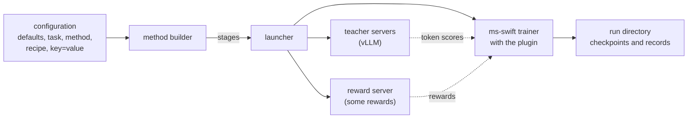

<p align="center">
  <picture>
    <source media="(prefers-color-scheme: dark)" srcset="assets/logo-dark.svg">
    
  </picture>
</p>

<p align="center">
  <b>Open post-training for medical vision-language models</b><br>
  Supervised fine-tuning, distillation and reinforcement learning on one protocol
</p>

<p align="center">
  <a href="https://github.com/JornyWan/med-residency/actions/workflows/tests.yml"></a>
  <a href="LICENSE"></a>
  <a href="pyproject.toml"></a>
  <a href="https://github.com/astral-sh/ruff"></a>
  <a href="CONTRIBUTING.md"></a>
</p>

<p align="center">
  <a href="#quick-start">Quick start</a> •
  <a href="#methods">Methods</a> •
  <a href="#tasks">Tasks</a> •
  <a href="#models">Models</a> •
  <a href="#benchmark">Benchmark</a> •
  <a href="#documentation">Documentation</a> •
  <a href="CONTRIBUTING.md">Contributing</a>
</p>

Pre-training is medical school. Residency is where a graduate becomes a specialist: by studying reference answers,
by working next to attending physicians, and by seeing how cases turn out. MedResidency is that stage for a medical
VLM. It trains a student with supervised fine-tuning on labels, with distillation from expert teachers, and with
reinforcement learning on task rewards, all in one code base and under one protocol.

Medical VLM papers usually post-train in their own code, on their own split, with their own backbone and
hyper-parameters. A new method is then compared with numbers copied from another setup, and it is hard to tell how
much of a difference comes from the method. In MedResidency a run is a **task**, a **method** and a **seed**:

```bash
medres train --task cxr_report --method adaopd --seed 42
```

The task fixes the student, the teachers, the data, the training budget and the evaluation. The method only changes
the loss. Every hyper-parameter lives in a YAML file in `configs/`, and every run records the configuration and the
exact commands it executed.

## Highlights

- **Nine methods on one protocol.** Label SFT, offline distillation, on-policy distillation with one or several
  teachers, GKD, two-stage training, CHORD, CHORD-φ, AdaOPD and GRPO share the student, the data, the budget and the
  evaluation of a task.
- **Four medical tasks.** Chest X-ray report generation, reasoning VQA, both at once with two teachers, and eight
  modality experts distilled into one student.
- **Layered YAML configuration.** `defaults ← task ← method ← recipe ← key=value`. Unknown keys are errors, so a typo
  cannot silently train with a default.
- **One launcher.** It starts the teacher servers, checks that each one serves the model it should, trains, and stops
  everything it started, also when the run fails or is cancelled. An interrupted run continues from its last complete
  checkpoint.
- **Reproducibility records.** Each run writes its resolved configuration, its commands, the package versions and the
  commit of the code to `<run>/medres/`.
- **Evaluation included.** The report metrics (RadCliQ-v1, RadGraph-F1, RaTEScore, CheXbert, GREEN), VQA accuracy,
  and paired bootstrap comparisons of two runs.
- **A gap probe.** It measures, on one GPU and before any training, how far a student's language is from a
  teacher's. This is the quantity AdaOPD steers by, and the benchmark lists it for 17 teacher–student pairs.
- **A benchmark with its commands.** The result of every method on every task, and the command behind each row.
- **No trainer of its own.** Training and the teacher servers are [ms-swift](https://github.com/modelscope/ms-swift)'s
  and sampling is [vLLM](https://github.com/vllm-project/vllm)'s. A method is one YAML file and one short function.

## Quick start

The core package needs no GPU:

```bash
git clone https://github.com/JornyWan/med-residency.git
cd med-residency
pip install -e .
medres list
medres train --task med_vqa --method opd --dry-run
```

The dry run prints everything a run would execute: the environment, the teacher servers and the training command
with all its arguments.

Training needs the training environment (ms-swift and vLLM, pinned) and, for the report metrics, a second small
environment. Two scripts build them; [docs/installation.md](docs/installation.md) explains both.

```bash
bash scripts/install_train_env.sh ~/envs/medres
conda activate ~/envs/medres
```

A complete run on public data, from download to scores:

```bash
bash scripts/download_models.sh med_vqa
medres data med-vqa --pmc-vqa raw/pmc_vqa --medxpertqa raw/medxpertqa --mmmu raw/mmmu --out data/med_vqa

medres train --task med_vqa --method opd --seed 42
medres eval run --task med_vqa --model runs/med_vqa_opd_s42/checkpoint-300
```

By default one run uses four GPUs of one node: two for the student and two for the teacher server. The benchmark was
run on 48 GB cards. [docs/concepts.md](docs/concepts.md) describes the layout and how to change it, and
`scripts/slurm/` has job templates.

## Methods

`medres list methods` prints them, and [docs/methods.md](docs/methods.md) says what each one optimizes.

| Method | `--method` | Learns from |
|:--|:--|:--|
| Label SFT | `sft` | reference answers |
| Offline distillation | `offline_kd` | answers the teacher wrote beforehand |
| On-policy distillation (OPD), one or several teachers | `opd` | the teacher's score of every token the student samples |
| GKD | `gkd` | the teacher's top-k distribution on the student's samples |
| Two-stage | `two_stage` | offline distillation, then OPD |
| CHORD | `chord` | SFT on teacher answers that fades into OPD |
| CHORD-φ | `chord_phi` | OPD with a small token-weighted SFT term |
| AdaOPD | `adaopd` | OPD and SFT on teacher answers, mixed by a measured gap |
| GRPO | `grpo` | a task reward, without a teacher |

## Tasks

`medres list tasks` prints them, and [docs/tasks.md](docs/tasks.md) describes each one.

| Task | Student | Teachers | Data |
|:--|:--|:--|:--|
| `cxr_report` | Qwen3-VL-2B | UniRG-CXR (8B) | MIMIC-CXR; tested on ReXrank MIMIC-CXR and IU X-ray |
| `med_vqa` | Qwen3-VL-2B | MediX-R1 (8B) | PMC-VQA; tested on PMC-VQA, MedXpertQA-MM and MMMU health |
| `cxr_report_vqa` | Qwen3-VL-2B | both of the above | both of the above, mixed |
| `modality_experts` | Qwen2-VL-2B | the eight Med-R1 experts (2B each) | OmniMedVQA |

## Models

`medres list models` prints the model zoo with the hub name of every entry.

| Role | Models |
|:--|:--|
| Students | Qwen3-VL-2B, Qwen3-VL-4B, Qwen2-VL-2B |
| Teachers of Qwen3-VL students | UniRG-CXR, MediX-R1, QoQ-Med3-VL and SonoReasoner (8B each) |
| Teachers of Qwen2-VL students | the eight modality experts of Med-R1 (2B each) |

The teachers are specialists: UniRG-CXR writes chest X-ray reports, MediX-R1 reasons through visual questions,
SonoReasoner reads ultrasound, and each Med-R1 expert covers one imaging modality. Distillation on single tokens needs
a teacher that shares the student's tokenizer, so a teacher comes from the student's model family. A model is one line
in `configs/models.yaml`; [docs/extending.md](docs/extending.md) shows how to add a model, a task, a method, a reward
or a test set.

## Benchmark

Report generation on MIMIC-CXR, 2B student, 8B teacher, three seeds per method. Higher 1/RadCliQ is better;
"Trunc." is the share of test reports that run into the generation limit, which is what a student that has collapsed
into repetition does.

| Method | MIMIC-CXR 1/RadCliQ | IU X-ray 1/RadCliQ | Trunc. (%) |
|:--|--:|--:|--:|
| Student before training | 0.548 | 0.678 | 48.9 |
| Teacher | 1.278 | 3.228 | 0.0 |
| Label SFT | 0.818 ± 0.015 | 1.551 ± 0.234 | 4.1 ± 2.7 |
| Offline KD | 0.841 ± 0.019 | 1.441 ± 0.068 | 6.9 ± 2.7 |
| OPD | 0.726 ± 0.074 | 1.749 ± 0.094 | 22.4 ± 18.3 |
| GKD | 0.919 ± 0.013 | 1.892 ± 0.109 | 0.0 ± 0.0 |
| CHORD | 0.913 ± 0.015 | 1.702 ± 0.227 | 1.2 ± 0.3 |
| CHORD-φ | 0.742 ± 0.129 | 1.746 ± 0.157 | 27.5 ± 37.6 |
| Two-stage | 0.892 ± 0.034 | 1.563 ± 0.176 | 3.4 ± 5.5 |
| AdaOPD | **0.931** ± 0.005 | **1.950** ± 0.030 | 0.8 ± 0.9 |

All tables, the other tasks, the ablations and the reproduction commands are in
[benchmarks/README.md](benchmarks/README.md). That page also says where the numbers come from and what has been
checked.

## How a run is put together



The configuration is plain YAML merged in a fixed order. The builder of the method turns it into one or more stages,
each an ms-swift command with its arguments. The launcher starts what a stage needs around the trainer, checks it,
runs the trainer and cleans up. Evaluation is a separate command that only needs a model directory.
[docs/concepts.md](docs/concepts.md) explains each step, and [docs/design.md](docs/design.md) says which conventions
come from TRL, LLaMA-Factory, verl, lmms-eval and rl-baselines3-zoo, and what was left out.

## Documentation

| | |
|:--|:--|
| [Installation](docs/installation.md) | the two environments, downloads, SLURM templates |
| [Concepts](docs/concepts.md) | runs, configuration layers, recipes, the launcher, resuming |
| [Methods](docs/methods.md) | what each method optimizes and which keys it has |
| [Tasks](docs/tasks.md) | the four built-in tasks |
| [Data](docs/data.md) | sources, licences, builders, file formats |
| [Evaluation](docs/evaluation.md) | scoring, comparing runs, the gap probe |
| [Extending](docs/extending.md) | adding a model, a task, a method, a reward or a test set |
| [Troubleshooting](docs/troubleshooting.md) | failures we ran into, and their fixes |
| [Design](docs/design.md) | what the framework borrows from general-domain ones, and what it leaves out |

## Data and privacy

The repository contains code, configuration and documentation only: no images, no reports, no model weights, no
per-sample outputs. MIMIC-CXR is credentialed data. You obtain it from PhysioNet under your own data-use agreement,
and what you build or generate from it stays under that agreement. The tools that touch such data print counts and
aggregate statistics, never text. Details are in [docs/data.md](docs/data.md).

MedResidency is research software. Models trained with it are not medical devices and must not be used for clinical
decisions.

## Contributing

New tasks, methods, models and benchmark rows are welcome; see [CONTRIBUTING.md](CONTRIBUTING.md). Results are
contributed as aggregate numbers together with the configuration that produced them.

## Citation

The paper that introduces AdaOPD and the benchmark is under review. Until it is public, please cite the software.
GitHub's "Cite this repository" button gives the same entry from [CITATION.cff](CITATION.cff).

```bibtex
@software{medresidency,
  title   = {MedResidency: open post-training of medical vision-language models},
  author  = {{The MedResidency authors}},
  year    = {2026},
  version = {0.1.0},
  url     = {https://github.com/JornyWan/med-residency}
}
```

## License

Apache-2.0 (see [LICENSE](LICENSE) and [NOTICE](NOTICE)). Every dataset and model keeps its own licence and terms
of use.

## Acknowledgements

MedResidency stands on [ms-swift](https://github.com/modelscope/ms-swift),
[vLLM](https://github.com/vllm-project/vllm) and [RadEval](https://github.com/jbdel/RadEval), and on the teams that
released the models and datasets of its tasks: Qwen-VL, UniRG-CXR, MediX-R1, Med-R1, MIMIC-CXR, ReXrank, IU X-ray,
PMC-VQA, MedXpertQA, MMMU and OmniMedVQA.
